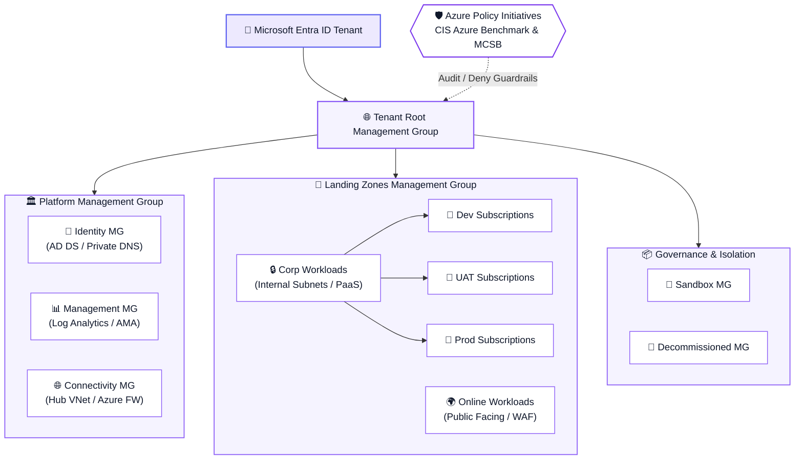
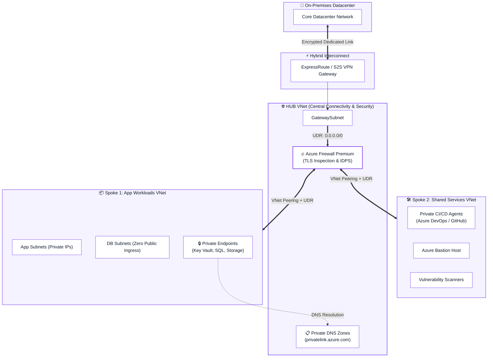
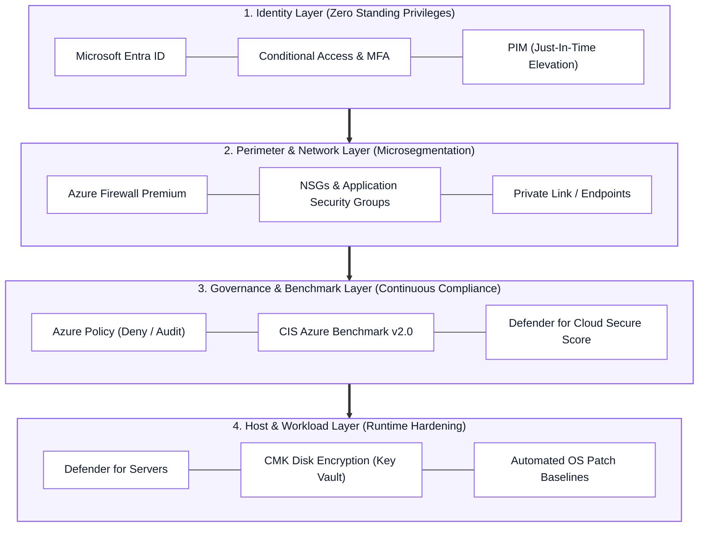
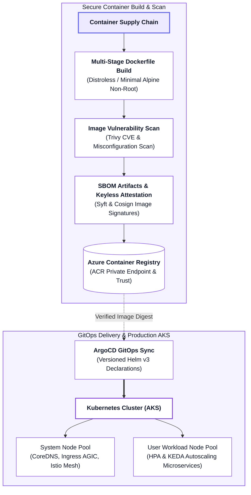
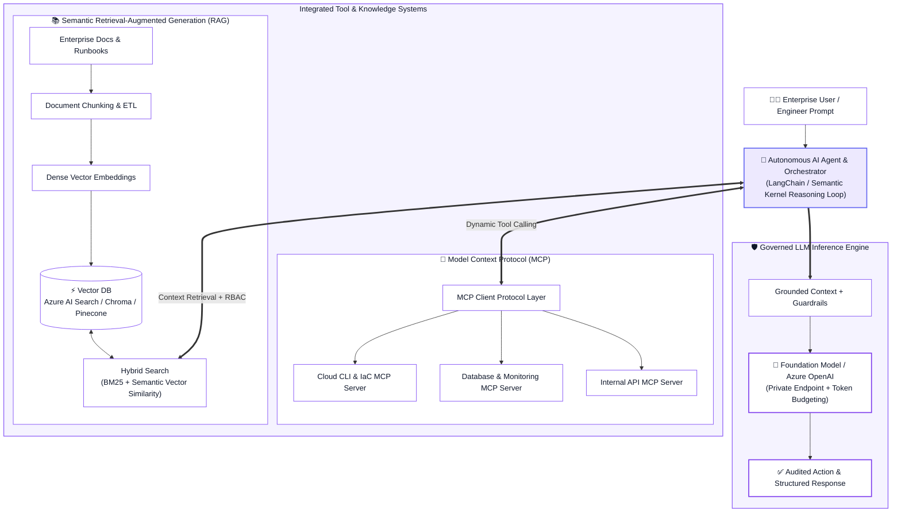

  <!-- Header Banner -->
  

  <!-- Dynamic Typing Subtitle: Terraform, Git, ADO YAML, Azure first -> Docker, K8s, AI & LLM in the end -->
  

  

    <b>Terraform IaC &bull; Git & Azure DevOps (ADO) YAML &bull; Microsoft Azure &bull; Zero-Trust DevSecOps &bull; Docker & Kubernetes &bull; Applied AI & LLMOps</b>
  

  <!-- Connect & Social Badges -->
  

    
    
    
    
  

---

## 🎯 Executive Profile & Core Philosophy

With **5+ years of hands-on enterprise experience**, I specialize in building resilient, enterprise-grade cloud ecosystems centered around **Terraform Infrastructure as Code (IaC)**, **Git & Azure DevOps (ADO) multi-stage YAML pipelines**, **Microsoft Azure Cloud Architecture**, and **Zero-Trust DevSecOps**. In addition, I architect modern container platforms with **Docker & Kubernetes (AKS/EKS)** and integrate cutting-edge **Applied AI & LLMOps systems (Model Context Protocol - MCP, RAG pipelines, and autonomous AI agents)**.

```mermaid
graph TD
    %% Root Node
    Portfolio["<b>🏛️ GITHUB DEVOPS & CLOUD ARCHITECTURE PORTFOLIO</b><br/><i>5+ Years Enterprise Experience &bull; Production Reference Architecture</i>"]

    %% Level 1: Five Core Enterprise Pillars
    Portfolio --> ALZ["<b>1. Azure Landing Zone (CAF)</b>"]
    Portfolio --> TF["<b>2. Terraform CI/CD Platform</b>"]
    Portfolio --> ADO["<b>3. Azure DevSecOps Platform</b>"]
    Portfolio --> K8S["<b>4. Container Supply Chain & K8s</b>"]
    Portfolio --> AI["<b>5. Applied AI & LLMOps Platform</b>"]

    %% Level 2: Sub-domains for Pillar 1 - Azure Landing Zone
    ALZ --> ALZ_1["<b>Management Hierarchy & RBAC</b><br/>• Entra ID Tenant Root & Management Groups<br/>• PIM & Just-In-Time (JIT) Role Elevation<br/>• Multi-Stage Approval Role Workflows"]
    ALZ --> ALZ_2["<b>Hub-and-Spoke Zero-Trust Network</b><br/>• ExpressRoute & S2S VPN Gateway Interconnect<br/>• Azure Firewall Premium (TLS & IDPS)<br/>• Private Endpoints & Hub Private DNS Zones"]
    ALZ --> ALZ_3["<b>Policy Guardrails & Governance</b><br/>• CIS Azure Benchmark & MCSB Initiatives<br/>• Automated Audit/Deny Policy Enforcement<br/>• Mandatory Resource Tagging & FinOps Budgets"]

    %% Level 2: Sub-domains for Pillar 2 - Terraform CI/CD
    TF --> TF_1["<b>Modular IaC Architecture</b><br/>• Parameterized Reusable Terraform Modules<br/>• Semantic Versioning (v1.x.x Release Tags)<br/>• Dev / UAT / Prod Variable Isolation"]
    TF --> TF_2["<b>Remote State Concurrency & Security</b><br/>• Azure Blob Storage with Blob Lease Locking<br/>• Customer-Managed Keys (CMK) Encryption<br/>• System-Assigned Managed Identity Auth"]
    TF --> TF_3["<b>Shift-Left FinOps & Drift Control</b><br/>• Infracost PR Cost Impact Guardrails<br/>• Automated Scheduled Drift Detection Pipelines<br/>• Static Linting (tflint & terraform fmt)"]

    %% Level 2: Sub-domains for Pillar 3 - Azure DevSecOps Platform (Matching user specification + complete context)
    ADO --> ADO_1["<b>Terraform Validation & IaC Scan</b><br/>• Static Analysis: terraform fmt & tflint<br/>• Security Scans: Checkov & tfsec<br/>• Secret Detection: GitLeaks & SonarQube"]
    ADO --> ADO_2["<b>Trunk-Based Git Governance</b><br/>• Protected main Branch (No Direct Push)<br/>• CODEOWNERS Enforced Path Approvals<br/>• Mandatory 2+ Senior Peer Sign-offs"]
    ADO --> ADO_3["<b>Multi-Stage ADO YAML Pipelines</b><br/>• Immutable Build & Plan Artifact Gates<br/>• Environment Approvals (Dev ➔ UAT ➔ Prod)<br/>• Automated Health Probes & Rollback Workflows"]

    %% Level 2: Sub-domains for Pillar 4 - Container Supply Chain (Matching user specification + complete context)
    K8S --> K8S_1["<b>Image Vulnerability Scan</b><br/>• Multi-Stage Dockerfile (Distroless / Minimal)<br/>• Non-Root Container Execution (USER 10001)<br/>• Trivy CVE & OS Dependency Scanning"]
    K8S --> K8S_2["<b>SBOM Artifacts & Supply Chain Security</b><br/>• Software Bill of Materials (SBOM) via Syft<br/>• Cryptographic Keyless Signing via Cosign<br/>• Azure Container Registry (ACR) Content Trust"]
    K8S --> K8S_3["<b>Production Kubernetes (AKS) Platform</b><br/>• System Node Pool vs User Workload Pool Isolation<br/>• HPA & KEDA Event-Driven Horizontal Autoscaling<br/>• ArgoCD GitOps Engine & Helm v3 Declarations"]

    %% Level 2: Sub-domains for Pillar 5 - Applied AI & LLMOps Platform
    AI --> AI_1["<b>Model Context Protocol (MCP)</b><br/>• Standardized MCP Server-Client Protocol<br/>• Cloud CLI & IaC Tool Invocations<br/>• Database & Monitoring API Integrations"]
    AI --> AI_2["<b>Enterprise Semantic RAG Pipeline</b><br/>• Automated Document Chunking & ETL<br/>• Vector DBs (Azure AI Search / Chroma / Pinecone)<br/>• Hybrid BM25 & Semantic Search with RBAC"]
    AI --> AI_3["<b>Autonomous Agents & LLMOps Guardrails</b><br/>• LangChain / Semantic Kernel Reasoning Loops<br/>• Private Azure OpenAI Endpoints via VNet<br/>• Token Budgeting, Rate Limiting & Prompt Defense"]

    %% Clean, high-contrast styling: 100% readable in light and dark modes
    style Portfolio fill:#ede9fe,stroke:#6366f1,stroke-width:2.5px,color:#0f172a

    style ALZ fill:#f5f3ff,stroke:#8b5cf6,stroke-width:2px,color:#0f172a
    style TF fill:#f5f3ff,stroke:#8b5cf6,stroke-width:2px,color:#0f172a
    style ADO fill:#f5f3ff,stroke:#8b5cf6,stroke-width:2px,color:#0f172a
    style K8S fill:#f5f3ff,stroke:#8b5cf6,stroke-width:2px,color:#0f172a
    style AI fill:#f5f3ff,stroke:#8b5cf6,stroke-width:2px,color:#0f172a

    style ALZ_1 fill:#ffffff,stroke:#8b5cf6,stroke-width:1.2px,color:#0f172a
    style ALZ_2 fill:#ffffff,stroke:#8b5cf6,stroke-width:1.2px,color:#0f172a
    style ALZ_3 fill:#ffffff,stroke:#8b5cf6,stroke-width:1.2px,color:#0f172a

    style TF_1 fill:#ffffff,stroke:#8b5cf6,stroke-width:1.2px,color:#0f172a
    style TF_2 fill:#ffffff,stroke:#8b5cf6,stroke-width:1.2px,color:#0f172a
    style TF_3 fill:#ffffff,stroke:#8b5cf6,stroke-width:1.2px,color:#0f172a

    style ADO_1 fill:#ffffff,stroke:#8b5cf6,stroke-width:1.5px,color:#0f172a
    style ADO_2 fill:#ffffff,stroke:#8b5cf6,stroke-width:1.2px,color:#0f172a
    style ADO_3 fill:#ffffff,stroke:#8b5cf6,stroke-width:1.2px,color:#0f172a

    style K8S_1 fill:#ffffff,stroke:#8b5cf6,stroke-width:1.5px,color:#0f172a
    style K8S_2 fill:#ffffff,stroke:#8b5cf6,stroke-width:1.5px,color:#0f172a
    style K8S_3 fill:#ffffff,stroke:#8b5cf6,stroke-width:1.2px,color:#0f172a

    style AI_1 fill:#ffffff,stroke:#8b5cf6,stroke-width:1.2px,color:#0f172a
    style AI_2 fill:#ffffff,stroke:#8b5cf6,stroke-width:1.2px,color:#0f172a
    style AI_3 fill:#ffffff,stroke:#8b5cf6,stroke-width:1.2px,color:#0f172a
```

---

## 📊 Enterprise Value & Proven Track Record

| Pillar | Measured Production Impact | Technologies & Methodologies |
| :--- | :--- | :--- |
| **Terraform IaC & Azure** | Standardized enterprise Azure landing zones using modular Terraform with blob lease locking, automated drift detection, and CAF governance | Terraform Modules, Azure Provider, Blob State Locking, Infracost, CAF |
| **Git & ADO YAML Automation** | **85%+ Reduction in Deployment Cycle Time** via trunk-based Git workflows, protected branches, and multi-stage Azure DevOps YAML pipelines | Git, Azure Repos, Azure DevOps (ADO) YAML Pipelines, CODEOWNERS |
| **DevSecOps Shift-Left** | **100% CI/CD Pipeline Scanning Coverage**; Automated CIS Azure Benchmark & ISO27001 policy enforcement | Checkov, tfsec, Trivy, GitLeaks, Azure Policy, PIM, Conditional Access |
| **Cloud Cost Optimization** | **28% Average Cloud Spend Reduction** across compute and storage without sacrificing SLA performance | FinOps Framework, Infracost, Rightsizing, 1-3yr RIs & Savings Plans, DCR Log Filtering |
| **High Availability & BCDR** | **99.99% Availability Architecture** with verified RTO < 30 mins and RPO < 5 mins | Availability Zones, VMSS, Azure Site Recovery (ASR), Paired Region Failover |
| **Enterprise Migrations** | Orchestrated datacenter-to-cloud migrations from on-premises environments to Azure with zero business downtime and dedicated hypercare | Azure Migrate, Discovery Assessments, Cutover Runbooks, TCO/ROI Sizing |
| **Docker & Kubernetes (AKS)** | Production Kubernetes clusters engineered with system/user node pool separation, HPA/KEDA autoscaling, and GitOps delivery | Docker Multi-Stage, Helm v3, ArgoCD, Ingress AGIC, Azure CNI, Calico |
| **Applied AI & LLMOps** | Implemented **Model Context Protocol (MCP)** tool servers, enterprise **RAG knowledge pipelines**, and autonomous DevOps agents | MCP Standard, Vector DBs, Hybrid Search, Azure OpenAI, LangChain |

---

## 🛠️ Technology Stack & Tooling Matrix

| Capability Domain | Enterprise Tools & Ecosystem |
| :--- | :--- |
| **Infrastructure as Code** |      |
| **Version Control & CI/CD** |  -0078D7?style=flat-square&logo=azuredevops&logoColor=white)    |
| **Cloud Platforms & Azure CAF** |     |
| **Security, Identity & Governance** |     -0078D4?style=flat-square&logo=microsoft&logoColor=white)  |
| **Observability, SRE & FinOps** |  -005BA1?style=flat-square&logo=microsoft&logoColor=white)     |
| **Containers & Orchestration** |  -326CE5?style=flat-square&logo=kubernetes&logoColor=white)  -EF7B4D?style=flat-square&logo=argo&logoColor=white)   |
| **Applied AI & LLMOps** | -8B5CF6?style=flat-square&logo=anthropic&logoColor=white) -10B981?style=flat-square&logo=openai&logoColor=white)    -F59E0B?style=flat-square&logo=databricks&logoColor=white) |

---

## 🏛️ Production Architecture & Deep Engineering Pillars

| 1. Scalable | 2. Robust | 3. Secure | 4. Reliable | 5. Portable |
| :---: | :---: | :---: | :---: | :---: |
| **6. Governed** | **7. High Availability** | **8. Cost-Optimized** | **9. Backed Up** | **10. Compliant & Monitored** |

---

<b>⚙️ 1. Terraform Landing Zone Automation & Production Pipeline Flow</b>

 

Automated, peer-reviewed Infrastructure as Code lifecycle with shift-left security scans, Infracost budget gates, and blob lease state concurrency:

```mermaid
flowchart LR
    subgraph CodeStage["1. Code & Verification"]
        Dev["👨‍💻 Dev Commit"] --> Git["📦 Git Repo (Feature Branch)"]
        Git --> Lint["🔍 Lint & Format<br/>(terraform fmt / tflint)"]
    end

    subgraph SecurityStage["2. Security & Guardrails"]
        Lint --> Sec["🛡️ Security Scanning<br/>(Checkov / tfsec / GitLeaks)"]
        Sec --> Cost["💰 Cost Estimation<br/>(Infracost Budget Guardrail)"]
    end

    subgraph PlanStage["3. Plan & Peer Approval"]
        Cost --> Plan["📋 Terraform Plan<br/>(Drift Detection & Artifact)"]
        Plan --> Gate{"🚦 Approval Gate<br/>(Min 2 Senior Reviews<br/>+ CODEOWNERS)"}
    end

    subgraph ApplyStage["4. Secure Deployment"]
        Gate -->|"Approved"| Apply["🚀 Terraform Apply<br/>(Remote State Locked)"]
        Apply --> State[("🔒 Azure Blob Storage<br/>Lease Lock & CMK")]
    end

    style CodeStage fill:#f5f3ff,stroke:#8b5cf6,stroke-width:1.5px,color:#0f172a
    style SecurityStage fill:#f5f3ff,stroke:#8b5cf6,stroke-width:1.5px,color:#0f172a
    style PlanStage fill:#f5f3ff,stroke:#8b5cf6,stroke-width:1.5px,color:#0f172a
    style ApplyStage fill:#f5f3ff,stroke:#8b5cf6,stroke-width:1.5px,color:#0f172a

    style Dev fill:#ffffff,stroke:#8b5cf6,stroke-width:1.2px,color:#0f172a
    style Git fill:#ffffff,stroke:#8b5cf6,stroke-width:1.2px,color:#0f172a
    style Lint fill:#ffffff,stroke:#8b5cf6,stroke-width:1.2px,color:#0f172a
    style Sec fill:#ffffff,stroke:#8b5cf6,stroke-width:1.2px,color:#0f172a
    style Cost fill:#ffffff,stroke:#8b5cf6,stroke-width:1.2px,color:#0f172a
    style Plan fill:#ffffff,stroke:#8b5cf6,stroke-width:1.2px,color:#0f172a
    style Gate fill:#ffffff,stroke:#7c3aed,stroke-width:2px,color:#0f172a
    style Apply fill:#ffffff,stroke:#7c3aed,stroke-width:2px,color:#0f172a
    style State fill:#ffffff,stroke:#8b5cf6,stroke-width:1.2px,color:#0f172a
```

- **Remote State Management:** Enterprise state stored in private Azure Storage Accounts with Blob Lease locking, encrypted at rest, and accessed strictly via Least-Privilege Managed Identities.
- **Modular IaC Architecture:** Standardized, reusable Terraform modules with semantic versioning (`v1.2.0`) and parameterized inputs.
- **Automated Drift Detection:** Scheduled nightly CI pipelines executing `terraform plan -detailed-exitcode` to detect and notify teams of manual console tampering.

---

<b>🚀 2. Azure DevSecOps Platform & Multi-Stage ADO YAML Pipelines</b>

 

Production-grade branching policies, Terraform validation, automated IaC scans, and multi-stage ADO release pipelines:

```mermaid
flowchart TD
    ADOPlatform["<b>Azure DevSecOps Platform</b>"]

    subgraph GitStrategy["Trunk-Based Git Governance"]
        ADOPlatform --> FB["🌿 Short-Lived Feature Branch (feature/*)"]
        FB --> PR["📑 Pull Request to main"]
        PR --> PRChecks["⚡ Automated Checks: Formatting & Linting"]
        PRChecks --> Approvals{"👥 2+ Senior Approvers<br/>+ CODEOWNERS"}
        Approvals -->|"Merge"| MainBranch["🌲 Protected main Branch"]
    end

    subgraph IaCPipeline["Terraform Validation & IaC Security"]
        MainBranch --> IaCScan["<b>Terraform Validation & IaC Scan</b><br/>(Checkov, tfsec & GitLeaks)"]
        IaCScan --> CostEst["💰 Infracost Budget Guardrail"]
        CostEst --> StageArtifact["📦 Immutable Plan Artifact"]
    end

    subgraph ADOPipeline["Multi-Stage ADO YAML Release"]
        StageArtifact --> StageDev["🧪 Auto Deploy -> DEV"]
        StageDev --> StageUAT["🏢 Integration Deploy -> UAT"]
        StageUAT --> ProdGate{"🚦 Production Gate:<br/>Architect Sign-off"}
        ProdGate -->|"Approved"| StageProd["🚀 Deploy -> PRODUCTION"]
        StageProd -.->|"Health Check Failure"| Rollback["⏪ Automated Rollback Plan"]
    end

    style ADOPlatform fill:#ede9fe,stroke:#6366f1,stroke-width:2.5px,color:#0f172a
    style GitStrategy fill:#f5f3ff,stroke:#8b5cf6,stroke-width:1.5px,color:#0f172a
    style IaCPipeline fill:#f5f3ff,stroke:#8b5cf6,stroke-width:1.5px,color:#0f172a
    style ADOPipeline fill:#f5f3ff,stroke:#8b5cf6,stroke-width:1.5px,color:#0f172a

    style FB fill:#ffffff,stroke:#8b5cf6,stroke-width:1.2px,color:#0f172a
    style PR fill:#ffffff,stroke:#8b5cf6,stroke-width:1.2px,color:#0f172a
    style PRChecks fill:#ffffff,stroke:#8b5cf6,stroke-width:1.2px,color:#0f172a
    style Approvals fill:#ffffff,stroke:#7c3aed,stroke-width:2px,color:#0f172a
    style MainBranch fill:#ffffff,stroke:#8b5cf6,stroke-width:1.2px,color:#0f172a
    style IaCScan fill:#ffffff,stroke:#8b5cf6,stroke-width:1.8px,color:#0f172a
    style CostEst fill:#ffffff,stroke:#8b5cf6,stroke-width:1.2px,color:#0f172a
    style StageArtifact fill:#ffffff,stroke:#8b5cf6,stroke-width:1.2px,color:#0f172a
    style StageDev fill:#ffffff,stroke:#8b5cf6,stroke-width:1.2px,color:#0f172a
    style StageUAT fill:#ffffff,stroke:#8b5cf6,stroke-width:1.2px,color:#0f172a
    style ProdGate fill:#ffffff,stroke:#7c3aed,stroke-width:2px,color:#0f172a
    style StageProd fill:#ffffff,stroke:#7c3aed,stroke-width:2px,color:#0f172a
    style Rollback fill:#ffffff,stroke:#ef4444,stroke-width:1.5px,color:#0f172a
```

- **Branching Model:** Trunk-based development with short-lived feature branches (`feature/*`, `fix/*`).
- **Strict Branch Policies on `main`:**
  - Mandatory Pull Request (PR) workflow with minimum 2 senior approvals.
  - `CODEOWNERS` validation enforced on critical infrastructure paths.
  - "No Direct Push" and "No Delete" protections on production branches.
- **Multi-Stage ADO YAML Pipelines:** Validate -> Security & Secrets Scan -> Immutable Build Plan -> Peer Gate -> Controlled Apply -> Health Probes & Rollback.
- **Custom Middleware & Image Bootstrapping:** VM Custom Data / Cloud-Init scripts for automated baseline configuration, security hardening, and agent provisioning at boot time.

---

<b>📐 3. Enterprise Cloud Governance & Management Hierarchy (Azure CAF)</b>

 

Implementing Microsoft **Cloud Adoption Framework (CAF)** across the six iterative phases: **Strategy**, **Plan**, **Ready**, **Adopt**, **Govern**, and **Secure & Manage**.

- **Subscription Boundaries:** Enforce strict segregation across lifecycle environments (`Dev`, `UAT`, `Prod`) and core functions (`Platform` vs `Workloads`) to prevent blast radius expansion and noisy-neighbor issues.
- **Enterprise Policy & Initiatives:** Centrally assign built-in initiatives (CIS Azure Benchmark, Microsoft Cloud Security Benchmark - MCSB) at the Management Group level with automated deny/audit guardrails and time-bound exception management.
- **Identity & Privilege:** Zero standing privileges; Microsoft Entra ID Privileged Identity Management (PIM) with just-in-time access, MFA, and multi-stage approval requirements.

---

<b>🌐 4. Enterprise Hub-and-Spoke Networking Architecture & Zero-Trust</b>

 

Centralized traffic orchestration, deep packet inspection, and micro-segmentation across hybrid datacenters and cloud spokes:

- **IP Address Management (IPAM):** Zero-overlap CIDR allocation bridging on-premises subnets and cloud address spaces.
- **Centralized Inspection & Egress:** User Defined Routes (UDRs) routing all egress (`0.0.0.0/0`) and spoke-to-spoke traffic through Azure Firewall Premium with TLS inspection and IDPS.
- **Private PaaS Exclusivity:** Private Endpoints for all data stores (Azure Key Vault, Storage Accounts, SQL Databases) linked to centralized Hub Private DNS Zones.
- **Inbound Security:** Ingress protected by Azure Application Gateway / Front Door with Web Application Firewall (WAF) policies.

---

<b>🛡️ 5. Multi-Layered Defense-in-Depth Security Matrix</b>

 

Comprehensive security controls applied across every structural boundary of the enterprise stack:

| Security Layer | Key Controls & Technologies |
| :--- | :--- |
| **Identity Level** | Microsoft Entra ID, Conditional Access policies, Mandatory MFA, Privileged Identity Management (PIM), Managed Identities for service-to-service auth. |
| **Networking Level** | Hub-and-Spoke topology, NSG/ASG micro-segmentation, Azure Firewall Premium with TLS inspection, DDoS Protection Standard, Private Endpoints. |
| **Governance Level** | Azure Policy initiatives (Deny unencrypted disks/public IPs), CIS Azure Benchmark, ISO27001, Microsoft Defender for Cloud Secure Score. |
| **Compute & Host** | Defender for Servers, automated vulnerability scanning (Trivy), Customer-Managed Keys (CMK) disk encryption, OS patch automation via Azure Update Manager. |

---

<b>📦 6. End-to-End Enterprise Cloud Migration Playbook</b>

 

Methodology for executing zero-downtime datacenter-to-cloud migrations at enterprise scale:

```mermaid
flowchart LR
    subgraph Phase1["1. Discovery"]
        D1["Azure Migrate Discovery"] --> D2["Dependency Mapping & Sizing"]
    end

    subgraph Phase2["2. Assessment"]
        D2 --> A1["TCO & ROI Analysis"] --> A2["6-R Migration Strategy"]
    end

    subgraph Phase3["3. Landing Zone Ready"]
        A2 --> R1["CAF Hub-Spoke Provisioning"] --> R2["VNet Peering & Security Baselines"]
    end

    subgraph Phase4["4. Cutover Execution"]
        R2 --> C1["Data Pre-Seeding & DB Sync"] --> C2["DNS Cutover & Validation"]
    end

    subgraph Phase5["5. Hypercare & Ops"]
        C2 --> H1["24x7 War Room Monitoring"] --> H2["Benchmarking & Handover"]
    end

    style Phase1 fill:#f5f3ff,stroke:#8b5cf6,stroke-width:1.5px,color:#0f172a
    style Phase2 fill:#f5f3ff,stroke:#8b5cf6,stroke-width:1.5px,color:#0f172a
    style Phase3 fill:#f5f3ff,stroke:#8b5cf6,stroke-width:1.5px,color:#0f172a
    style Phase4 fill:#f5f3ff,stroke:#8b5cf6,stroke-width:1.5px,color:#0f172a
    style Phase5 fill:#f5f3ff,stroke:#8b5cf6,stroke-width:1.5px,color:#0f172a

    style D1 fill:#ffffff,stroke:#8b5cf6,stroke-width:1.2px,color:#0f172a
    style D2 fill:#ffffff,stroke:#8b5cf6,stroke-width:1.2px,color:#0f172a
    style A1 fill:#ffffff,stroke:#8b5cf6,stroke-width:1.2px,color:#0f172a
    style A2 fill:#ffffff,stroke:#8b5cf6,stroke-width:1.2px,color:#0f172a
    style R1 fill:#ffffff,stroke:#8b5cf6,stroke-width:1.2px,color:#0f172a
    style R2 fill:#ffffff,stroke:#8b5cf6,stroke-width:1.2px,color:#0f172a
    style C1 fill:#ffffff,stroke:#8b5cf6,stroke-width:1.2px,color:#0f172a
    style C2 fill:#ffffff,stroke:#8b5cf6,stroke-width:1.2px,color:#0f172a
    style H1 fill:#ffffff,stroke:#8b5cf6,stroke-width:1.2px,color:#0f172a
    style H2 fill:#ffffff,stroke:#8b5cf6,stroke-width:1.2px,color:#0f172a
```

### Complete Migration Lifecycle Checklists:
- **Pre-Migration:** Azure Migrate discovery reports, application dependency mapping, bandwidth sizing, target Landing Zone verification, and pre-migration backup validation.
- **During Migration (Cutover):** Data pre-seeding, continuous database replication synchronization, reduced DNS TTLs, automated smoke testing, and scheduled cutover execution.
- **Post-Migration & Hypercare:** Health telemetry validation, end-user sanity testing, performance benchmarking, and 2-4 weeks dedicated war room support.

---

<b>💰 7. FinOps (Cloud Financial Management & Cost Optimization)</b>

 

Instituting financial discipline, visibility, and measurable cost reduction across enterprise cloud resources:

- **Waste Elimination:** Automated serverless tasks detecting and deleting orphaned managed disks, unassociated public IPs, obsolete snapshots, and unused NICs.
- **Compute Rightsizing:** Continuous right-sizing analysis based on 30-day P95 CPU and Memory utilization profiles.
- **Commitment Discounts:** Strategically procured 1-Year and 3-Year Reserved Instances (RIs) and Azure Savings Plans for steady-state workloads, yielding **up to 40% cost reduction**.
- **Automated Scheduling:** Automated start/stop workflows for non-production environments outside standard business hours.
- **Log Ingestion Tuning:** Configured Azure Monitor Data Collection Rules (DCRs) to filter verbose, low-value diagnostic tables, preventing run-away Log Analytics ingestion bills.

---

<b>🔄 8. High Availability, Backup & Disaster Recovery (BCDR)</b>

 

Architected for mission-critical reliability and rapid recovery:

- **Storage Redundancy:** Tiered selection between Locally Redundant Storage (LRS), Zone-Redundant Storage (ZRS), and Geo-Redundant Storage (GRS) based on data classification.
- **High Availability Compute:** Virtual Machine Scale Sets (VMSS) deployed across multiple Availability Zones with automatic health checks and auto-scaling.
- **RTO & RPO Precision:**
  - **RTO (Recovery Time Objective):** Maximum allowable downtime `< 30 minutes` for critical tier-1 applications.
  - **RPO (Recovery Point Objective):** Continuous asynchronous database replication targeting `< 5 minutes` transaction loss limit.
- **Cross-Region Disaster Recovery:** Azure Site Recovery (ASR) replicating to Azure paired regions with semi-annual automated DR drills.

---

<b>📈 9. Enterprise Observability & Incident Response</b>

 

Full-stack visibility across infrastructure, platform, and application tiers:

- **Centralized Log Analytics:** Distributed workspaces with unified KQL (Kusto Query Language) operational dashboards and workbooks.
- **Azure Monitor Agent (AMA):** Consolidated agent architecture utilizing Data Collection Rules (DCRs) to ingest granular system and security events.
- **Dynamic Alerting & Escalation:** Action Groups dynamically routing incidents to Microsoft Teams channels, Slack, and PagerDuty for immediate SLA resolution.

---

<b>🤝 10. Vendor Management & Delivery Governance</b>

 

Bridging engineering execution with executive commercial accountability:

```mermaid
flowchart LR
    RFI["📝 1. RFI<br/>Market Sizing"] --> RFP["📋 2. RFP<br/>Technical Scope"]
    RFP --> Matrix["📊 3. Technical Matrix<br/>Architecture & Security Score"]
    Matrix --> SOW["📜 4. SOW & Milestones<br/>Commercials & Penalty SLAs"]
    SOW --> Execution["⚙️ 5. Sprint Execution<br/>RACI Ownership & Burn-down"]
    Execution --> Signoff["✅ 6. Knowledge Transfer<br/>& Formal Sign-Off"]

    style RFI fill:#ffffff,stroke:#8b5cf6,stroke-width:1.2px,color:#0f172a
    style RFP fill:#ffffff,stroke:#8b5cf6,stroke-width:1.2px,color:#0f172a
    style Matrix fill:#ffffff,stroke:#8b5cf6,stroke-width:1.2px,color:#0f172a
    style SOW fill:#ffffff,stroke:#8b5cf6,stroke-width:1.2px,color:#0f172a
    style Execution fill:#ffffff,stroke:#8b5cf6,stroke-width:1.2px,color:#0f172a
    style Signoff fill:#ede9fe,stroke:#6366f1,stroke-width:2px,color:#0f172a
```

- **SOW & Commercial Governance:** Drafting Statements of Work (SOWs), establishing technical deliverables, acceptance criteria, milestone schedules, and penalty clauses.
- **Technical Evaluation Matrix:** Objective scoring of vendors against architecture design, security benchmarks, operational maturity, and commercial viability.
- **RACI Matrix Accountability:** Defining clear ownership across Responsible, Accountable, Consulted, and Informed stakeholders.
- **Escalation & SLA Protocols:** Documented escalation trees to address technical blockers and contract SLAs.
- **Team Leadership & Mentorship:** Conducting technical KT sessions, running Architecture Review Boards (ARBs), and upskilling engineering teams.

---

<b>🐳 11. Container Supply Chain & Production Kubernetes (AKS/EKS) Architecture</b>

 

Enterprise container supply chain security, image vulnerability scanning, SBOM artifact attestation, and GitOps deployments:

- **Hardened Containerization:** Multi-stage Docker builds separating compile-time dependencies from minimal runtime environments (`distroless` / `alpine`), enforcing non-root user execution (`USER 10001`), and minimizing container attack surface.
- **Cluster Architecture & Isolation:** Dedicated **System Node Pool** (hosting core infrastructure components) isolated from **User Node Pools** (application workloads); cluster managed using Azure Managed Identities with Azure CNI for direct VNet pod routing.
- **Secrets & Configuration:** Azure Key Vault Provider for Secrets Store CSI Driver enabling dynamic secret injection directly into pods without persisting sensitive credentials in etcd.
- **Autoscaling & Traffic Routing:**
  - **HPA & KEDA:** Horizontal Pod Autoscaler coupled with Kubernetes Event-Driven Autoscaling (KEDA) scaling pods based on CPU/memory percentiles and queue depth (e.g., Azure Service Bus, Kafka).
  - **Ingress & Service Mesh:** Ingress routing managed via Azure Application Gateway Ingress Controller (AGIC) / NGINX Ingress with mutual TLS (mTLS) enforcement via Istio.
- **GitOps Continuous Delivery:** GitOps synchronization using **ArgoCD** driven by versioned **Helm v3** charts, ensuring cluster state perfectly matches the git repository with automated drift remediation.

---

<b>🤖 12. Applied AI, LLMOps & Agentic Systems (MCP, RAG & Autonomous Agents)</b>

 

Bridging modern generative AI capabilities with enterprise cloud infrastructure and automated operations:

- **Model Context Protocol (MCP) Integration:** Implemented Anthropic's open **Model Context Protocol (MCP)** to connect LLM agent workflows safely to external tool servers, enterprise databases, and cloud infrastructure management APIs without hardcoding custom wrappers.
- **Retrieval-Augmented Generation (RAG) Architecture:**
  - **Document Processing Pipeline:** Automated ETL chunking, embedding generation using state-of-the-art embedding models, and storage in managed vector databases (Azure AI Search, Pinecone, Chroma).
  - **Hybrid Search & Grounding:** Combining BM25 keyword matching with dense vector similarity search; enforcing role-based access control (RBAC) filtering so users and agents only retrieve authorized context.
- **Autonomous AI Agents & Workflows:** Built task-decomposition agent workflows utilizing planning loops, dynamic tool selection, memory persistence, and human-in-the-loop verification gates for critical production operations.
- **LLMOps, Security & Cost Control:** Private endpoint isolation for Azure OpenAI endpoints, token usage monitoring and budget caps, prompt versioning, and defensive guardrails against prompt injection.

---

## 📈 GitHub Activity & Engineering Analytics

  <table border="0">
    <tr>
      <td>
        
      </td>
      <td>
        
      </td>
    </tr>
    <tr>
      <td colspan="2" align="center">
        
      </td>
    </tr>
  </table>

---

## 💬 Connect, Collaborate & Inquire

Whether you want to discuss **Terraform modular landing zones**, **Azure DevOps YAML automation**, **enterprise cloud architecture**, **Docker & Kubernetes clusters**, or **MCP / RAG agentic AI systems**, let's connect!

 

